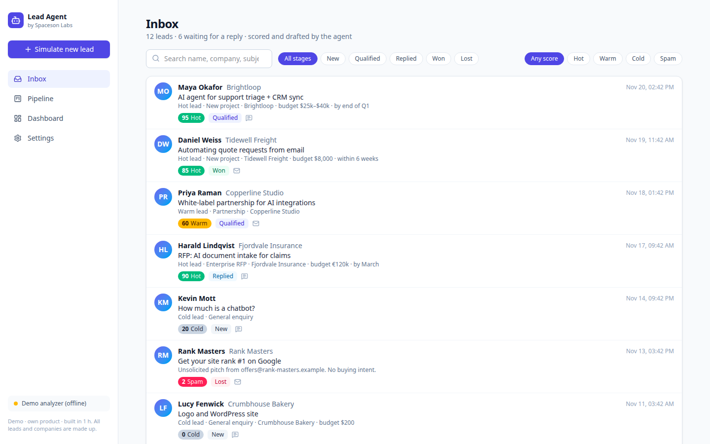
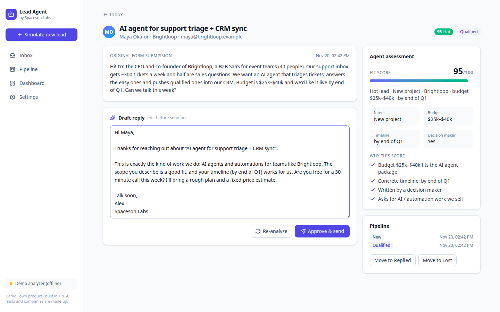
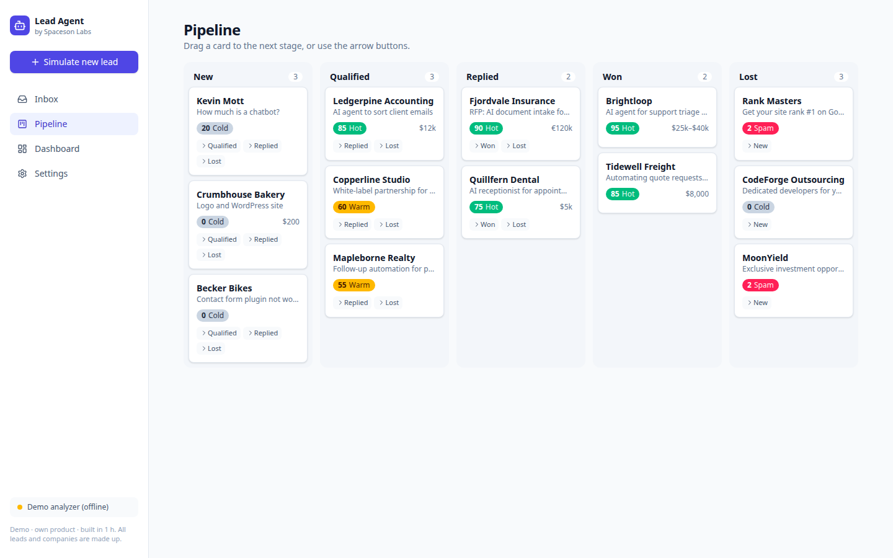
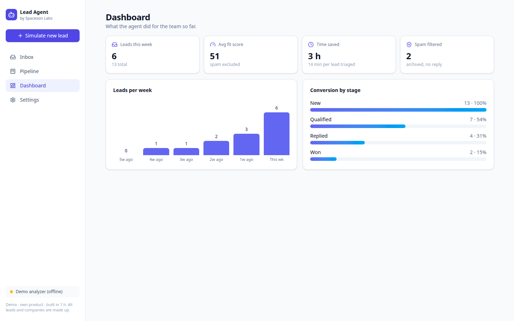
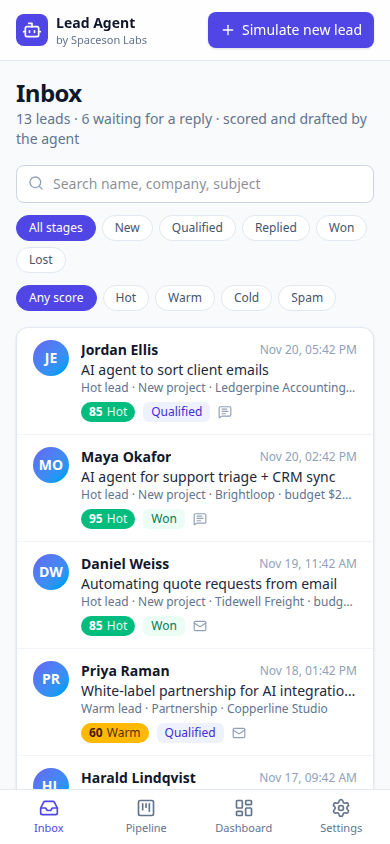

# AI Lead Agent

**Demo · own product · built in 1 h** by Spaceson Labs.

An inbound lead triage app for small B2B teams. Contact-form submissions and emails land in one inbox. An AI agent reads each lead, scores its fit (0–100), pulls out budget, timeline, intent and whether the sender is a decision maker, explains the score and drafts a reply. A person reviews or edits the draft and clicks **Approve & send**. Leads move through a pipeline: New → Qualified → Replied → Won / Lost.

> All leads, people and companies in this demo are made up. Email domains use the reserved `.example` TLD. No real clients are shown.



## Screens

| Inbox                                  | Lead detail                                  |
| -------------------------------------- | -------------------------------------------- |
|        |  |
| **Pipeline**                           | **Dashboard**                                |
|  |      |

Mobile (390 px):



- **Inbox**: every lead with its score badge and stage; filter by stage, score band and text.
- **Lead detail**: original message, extracted fields, score with reasons, editable draft, Approve & send, stage history and moves.
- **Pipeline**: kanban by stage; drag a card or use the arrow buttons. Only valid moves are allowed (a lead can't jump from New to Won).
- **Dashboard**: leads per week, average fit score, time saved, spam filtered, conversion by stage.
- **Simulate new lead**: paste any text; the agent analyzes it live and it appears in the inbox.

Everything is saved in `localStorage`, so the state survives a reload. To start over, clear site data.

## How the analysis works

All analysis goes through one interface:

```ts
type LeadAnalyzer = {
  analyze: (input: LeadInput) => Promise<Analysis>;
};
```

**Demo mode (default)** is a deterministic rule-based analyzer (`src/leads/analyzer.ts`). It looks for budget amounts and ranges, deadlines, decision-maker titles, the kind of work asked for, and spam patterns, then builds the score, the reasons and a reply from templates. It waits about a second to feel like an agent thinking. No network, no key.

**Live mode** (`src/leads/live-analyzer.ts`) sends the lead to the Groq chat completions API with model `openai/gpt-oss-120b` and asks for one JSON object. The reply is checked against a schema (`src/leads/contract.ts`): wrong categories, a score outside 0–100 or missing fields are rejected and shown as an error, never saved.

To try it, open **Settings**, choose **Live**, and paste your Groq API key. The key stays in memory only: it is not written to storage and is gone after a reload. Requests go straight from your browser to `api.groq.com`. For a production setup the call would move behind a small server so the key never reaches the browser.

## Run it

Requires Node 22+ and pnpm.

```sh
pnpm install
pnpm dev        # http://localhost:5173
pnpm test       # unit tests (vitest)
pnpm build      # type-check + production build to dist/
pnpm preview    # serve the build
```

The build is a static site (hash routing), so `dist/` can be hosted anywhere.

## Stack

React 19, TypeScript (strict), Vite, Tailwind CSS 4, Effector for state, effector-storage for persistence, `@withease/contracts` for schema checks, lucide icons.
